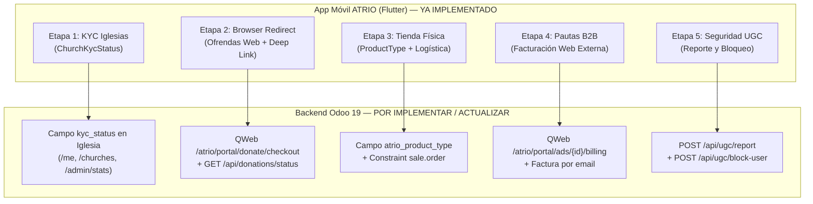

# Especificación Técnica de Sincronización Backend (Odoo 19) — Cumplimiento App Store & Google Play (ATRIO)

> **Destinatario:** Equipo de Ingeniería Backend Odoo 19 y agente **Claude Code**.  
> **Fecha de actualización en App Móvil (Flutter):** 4 de noviembre de 2026  
> **Prefijo base de la API REST en Odoo 19:** `/atrio/portal/api`  
> **Prefijo base de rutas web públicas/autenticadas en Odoo 19:** `/atrio/portal`

---

## 🤖 Instrucciones Directas para Claude Code (Contexto de Ejecución en Odoo 19)

Si estás leyendo este archivo como **Claude Code** dentro del repositorio del módulo de Odoo 19 de ATRIO:
1. La aplicación móvil Flutter (**ATRIO**) ya fue actualizada en sus 6 etapas de cumplimiento legal y transaccional para **Apple App Store (Guidelines 1.2, 3.1.1, 3.1.5(a), 3.2.1(vi))** y **Google Play Store (Payments & UGC Policies)**.
2. Tu objetivo es **crear o actualizar los modelos, controladores HTTP (`http.Controller`) y vistas QWeb en Odoo 19** para que coincidan **exactamente** con las firmas de endpoints, nombres de llaves JSON (`snake_case`), códigos de estado HTTP y redirecciones Deep Link detalladas en este documento.
3. **Regla de retrocompatibilidad:** No elimines campos existentes en `/me`, `/churches`, `/admin/stats` ni `/admin/ads`. Agrega los nuevos campos manteniendo intacta la estructura actual.

---

## Mapa General de Cambios entre Flutter y Odoo 19



---

## ETAPA 1: Máquina de Estados KYC para Congregaciones (`kyc_status`)

### 1.1 Propósito Legal
Ninguna congregación (`church_id`) puede habilitar el botón **"Ofrendar"** ni recaudar fondos en la app móvil hasta que el equipo legal de ATRIO valide su documentación sin fines de lucro:
- **República Dominicana (`DO`):** RNC de Institución Sin Fines de Lucro (**Ley 122-05**) + cuenta bancaria institucional.
- **Honduras (`HN`):** **Personería Jurídica** + **RTN** sin fines de lucro + cuenta bancaria institucional.

### 1.2 Modelo en Odoo 19 (`atrio.church` / `res.partner`)
Agregar (o estandarizar) el campo `kyc_status` de tipo `fields.Selection`:

```python
kyc_status = fields.Selection(
    selection=[
        ('draft', 'Borrador (Sin documentación)'),
        ('pending_kyc', 'Validación KYC en curso'),
        ('approved', 'Verificada y Aprobada (KYC OK)'),
        ('suspended', 'Recaudación Suspendida por Auditoría'),
    ],
    string='Estado KYC Institucional',
    default='draft',
    required=True,
    tracking=True,
)
```

> **Valores exactos aceptados por el parser de Flutter (`ChurchKycStatus.fromString`):**  
> `'draft'`, `'pending_kyc'`, `'approved'`, `'suspended'`.

### 1.3 Endpoints Existentes que DEBEN Incluir `kyc_status`

#### A) `GET /atrio/portal/api/me`
Flutter (`UserModel.fromOdooJson`) lee el estado KYC desde `church.kyc_status` (o `church.verification_status` o `church_kyc_status` en la raíz):

```json
{
  "user": {
    "id": 45,
    "name": "Juan Pérez",
    "email": "juan@iglesia.org",
    "role": "member"
  },
  "church": {
    "id": 12,
    "name": "Iglesia Bautista Renacer",
    "has_active_subscription": true,
    "kyc_status": "approved"
  },
  "church_kyc_status": "approved",
  "membership_status": "approved"
}
```

#### B) `GET /atrio/portal/api/churches` y `GET /atrio/portal/api/churches/{id}`
Flutter (`IglesiaModel.fromJson`) lee `kyc_status` y `es_verificada`:

```json
{
  "id": 12,
  "nombre": "Iglesia Bautista Renacer",
  "es_verificada": true,
  "kyc_status": "approved"
}
```

#### C) `GET /atrio/portal/api/admin/stats`
Flutter (`AdminChurchStatsModel.fromJson`) lee `kyc_status` en la raíz del JSON o dentro de `offerings.kyc_status` para renderizar el banner `_ChurchKycStatusBanner` en el **Dashboard Pastoral Móvil**:

```json
{
  "period": "month",
  "kyc_status": "pending_kyc",
  "members": { "active": 120, "pending": 4, "new": 8 },
  "offerings": {
    "count": 35,
    "total": 45000.0,
    "kyc_status": "pending_kyc",
    "currency": { "code": "DOP", "symbol": "RD$" }
  }
}
```

### 1.4 Regla de Bloqueo en Backend
Si un usuario intenta crear una transacción de ofrenda para una iglesia cuyo `kyc_status != 'approved'`, el backend debe responder con HTTP `403 Forbidden`:

```json
{
  "error": "kyc_not_approved",
  "message": "La congregación aún no cuenta con la validación institucional (KYC) aprobada para recibir ofrendas."
}
```

---

## ETAPA 2: Arquitectura "Browser Redirect" para Ofrendas y Deep Link `atrio://donation-completed`

### 2.1 Propósito Legal
Conforme a **Apple Guideline 3.2.1(vi)**, las donaciones y ofrendas a organizaciones verificadas sin fines de lucro no pueden procesarse con formularios de pago incrustados dentro de un WebView interno, sino mediante un navegador externo seguro (`SFSafariViewController` en iOS / `Chrome Custom Tabs` en Android) que procesa el pago en la web de Odoo 19 y retorna automáticamente a la app mediante el esquema nativo `atrio://donation-completed`.

### 2.2 NUEVA Ruta Web QWeb: `GET /atrio/portal/donate/checkout`
Cuando el feligrés pulsa **"Continuar al Portal Web"** en la app, Flutter (`AtrioApi.createDonationWebCheckoutUrl`) construye y abre la siguiente URL en `SFSafariViewController` / `Chrome Custom Tabs`:

```text
GET {baseUrl}/atrio/portal/donate/checkout?tx_id={txId}&concept={concept}&amount={amount}&currency={currency}&church_id={churchId}&token={jwtToken}
```

#### Parámetros Query Recibidos por Odoo 19:
| Parámetro | Tipo | Obligatorio | Descripción |
| :--- | :--- | :---: | :--- |
| `tx_id` | `string` | Sí | Identificador único generado por la app o pre-registrado (ej. `TX-1730770000123`). |
| `concept` | `string` | Sí | Concepto de la ofrenda (`Diezmo`, `Ofrenda`, `Campaña especial`, `Ayuda comunitaria`, `Otro aporte`). |
| `amount` | `string` (float) | Sí | Monto numérico (ej. `1500.00`). |
| `currency` | `string` | Sí | Código o símbolo de moneda (`RD$`, `DOP`, `L`, `HNL`, `USD`). |
| `church_id` | `int` | No | ID de la iglesia destino en Odoo 19 (si no se envía, tomar `user.church_id` del `token`). |
| `token` | `string` | No | Access Token JWT del usuario para autenticar automáticamente la sesión web sin pedir login de nuevo. |

#### Comportamiento Requerido en el Controlador Web de Odoo 19:
1. Validar el `token` JWT (si está presente) para asociar el aporte al feligrés (`res.partner` / `atrio.member`) y a su congregación (`church_id`).
2. Verificar que la congregación tenga `kyc_status == 'approved'`.
3. Renderizar una página QWeb responsiva (Mobile-First) con el resumen de la ofrenda y las opciones de pago en la web (PayPal / Tarjeta / Transferencia bancaria en portal web).
4. Registrar el estado de la transacción asociada al `tx_id`.
5. **Redirección Automática al Finalizar:** Una vez completado o registrado el pago en la web, redirigir el navegador hacia el Deep Link registrado en `AndroidManifest.xml` e `Info.plist`:
   ```text
   atrio://donation-completed?tx_id={tx_id}&status=completed
   ```
   *(También incluir en la página de éxito un botón visible `<a href="atrio://donation-completed?tx_id=...">Volver a ATRIO</a>` por si el navegador móvil bloquea redirecciones automáticas sin gesto del usuario).*

### 2.3 NUEVO Endpoint API: `GET /atrio/portal/api/donations/status`
Cuando la app intercepta el Deep Link `atrio://donation-completed?tx_id=...` en `DeepLinkService`, cierra automáticamente el navegador y consulta a Odoo 19 el estado real de la transacción antes de desplegar el modal pastoral de gratitud (`DonationGratitudeModal`).

- **Método y Ruta:** `GET /atrio/portal/api/donations/status?tx_id={tx_id}`
- **Autenticación:** `Authorization: Bearer <token>` (opcionalmente público por `tx_id` si el usuario donó como invitado).
- **Respuesta JSON Esperada (HTTP 200):**

```json
{
  "status": "completed",
  "state": "completed",
  "tx_id": "TX-1730770000123",
  "verified": true,
  "amount": 1500.0,
  "currency": "RD$",
  "concept": "Diezmo",
  "church_id": 12,
  "created_at": "2026-11-04T23:00:00Z"
}
```

> **Nota sobre valores de `status` / `state`:**  
> `DeepLinkService` considera no fallida cualquier respuesta cuyo `status` (o `state`) sea `'completed'`, `'approved'`, `'done'`, `'pending_verification'`, etc. Solo aborta el modal de gratitud si `status` es `'failed'`, `'cancelled'` o `'rejected'`.

---

## ETAPA 3: Tienda Eclesial Física, Aislamiento de Carrito y Logística Obligatoria

### 3.1 Propósito Legal
Bajo **Apple Guideline 3.1.5(a)** y las políticas de Google Play, las pasarelas de pago externas solo están permitidas para **bienes físicos tangibles** (libros impresos, Biblias físicas, indumentaria, artículos ministeriales). Está estrictamente prohibido mezclar bienes físicos y digitales en una misma orden (`sale.order`), y todo pedido físico debe registrar datos de entrega o recogida presencial en el templo.

### 3.2 Modelo `product.template` en Odoo 19
Agregar el campo `atrio_product_type` en `product.template`:

```python
from odoo import models, fields

class ProductTemplate(models.Model):
    _inherit = 'product.template'

    atrio_product_type = fields.Selection(
        selection=[
            ('physical', 'Bien Físico / Tangible'),
            ('digital', 'Contenido Digital'),
        ],
        string='Naturaleza del Producto (ATRIO Compliance)',
        default='physical',
        required=True,
    )
```

#### Exposición en JSON de Productos:
El parser de Flutter (`ProductoModel.fromJson` / `ProductoModel.parseProductType`) lee cualquiera de las llaves `atrio_product_type`, `product_type` o `tipo_producto` con valores `'physical'` o `'digital'`:

```json
{
  "id": 101,
  "nombre": "Biblia de Estudio RVR1960 (Edición Impresa Tapa Dura)",
  "categoria": "Libros",
  "precio": 1250.0,
  "atrio_product_type": "physical"
}
```

### 3.3 Restricción ("Doble Barrera") en `sale.order` en Odoo 19
En el modelo `sale.order`, implementar la validación `@api.constrains('order_line')` para impedir en base de datos carritos mixtos:

```python
from odoo import models, fields, api
from odoo.exceptions import ValidationError

class SaleOrder(models.Model):
    _inherit = 'sale.order'

    atrio_delivery_method = fields.Selection(
        selection=[
            ('shipping', 'Envío a domicilio'),
            ('pickup', 'Recogida presencial en el templo'),
        ],
        string='Método de Entrega (ATRIO)',
        default='shipping',
    )
    atrio_shipping_address = fields.Text(string='Dirección Física de Entrega')
    atrio_pickup_confirmed = fields.Boolean(
        string='Confirmación de Recogida en Iglesia',
        default=False,
    )

    @api.constrains('order_line')
    def _check_single_product_type(self):
        for order in self:
            types = set(
                order.order_line.mapped('product_id.product_tmpl_id.atrio_product_type')
            )
            # Filtrar valores falsos si algún producto antiguo no tuviera valor
            types = {t for t in types if t}
            if len(types) > 1:
                raise ValidationError(
                    'Por políticas de cumplimiento de App Store y Google Play, '
                    'no es posible mezclar productos físicos y digitales en una misma orden.'
                )
```

---

## ETAPA 4: Pauta Publicitaria B2B (`/admin/ads`) — Facturación y Pago Externo

### 4.1 Propósito Legal
En el módulo de publicidad para administradores de iglesia (`church_admin`), la aplicación móvil permite **crear, segmentar y cotizar** la campaña (`POST /admin/ads/quote`, `POST /admin/ads`, `GET /admin/ads`), pero **eliminó por completo el cobro in-app y la subida de comprobantes dentro de la app**. Todo el proceso de pago y facturación se realiza como transacción B2B fuera de la app.

### 4.2 NUEVA Ruta Web de Facturación B2B: `GET /atrio/portal/ads/{ad_id}/billing`
Cuando el `church_admin` pulsa **"Pagar en el Portal Web de Facturación"** en `AdPaymentScreen`, Flutter (`AdsProvider.openExternalBillingPortal(adId)`) abre el navegador externo del sistema (`LaunchMode.externalApplication`) hacia:

```text
GET {baseUrl}/atrio/portal/ads/{ad_id}/billing
```

#### Lo que debe hacer esta página web en Odoo 19:
1. Mostrar la orden de facturación B2B de la campaña publicitaria (`ad_id`) usando los mismos datos que devuelve `GET /atrio/portal/api/admin/ads/{ad_id}/payment` (título de la campaña, monto total, moneda, desglose de semanas/alcance).
2. Permitir en esa página web:
   - Pagar con **PayPal** (reutilizando la lógica de `/admin/ads/{ad_id}/pay/paypal`).
   - Subir el comprobante de **Transferencia Bancaria** desde el navegador web (reutilizando la lógica de `/admin/ads/{ad_id}/pay/transfer`).
3. Además, cuando una campaña pase a estado `approved_pending_payment` (`payable`), disparar por correo electrónico al `church_admin` la orden de cobro con el enlace directo a `{baseUrl}/atrio/portal/ads/{ad_id}/billing`.

> **Nota de compatibilidad:** Mantener activo el endpoint `GET /atrio/portal/api/admin/ads/{ad_id}/payment` porque la app móvil lo sigue consultando en modo lectura para mostrar el resumen de la orden de facturación B2B (`amount`, `currency`, `ad_title`, `status`) antes de redirigir al navegador externo.

---

## ETAPA 5: Cumplimiento UGC (Contenido Generado por el Usuario) — Reporte y Bloqueo

### 5.1 Propósito Legal
Conforme a **Apple Guideline 1.2** y **Google Play UGC Policy**, además del panel de moderación para `platform_admin` (`/platform/moderation/*`), los miembros regulares (`member`) ahora disponen de un menú contextual en las publicaciones/avisos comunitarios con dos acciones obligatorias:
1. **Reportar contenido inapropiado** (`POST /atrio/portal/api/ugc/report`).
2. **Bloquear autor / contenido** (`POST /atrio/portal/api/ugc/block-user`).

### 5.2 NUEVO Endpoint: `POST /atrio/portal/api/ugc/report`
Llamado por `AtrioApi.reportUgcContent` y `ModerationService.reportUgcContent`.

- **Método y Ruta:** `POST /atrio/portal/api/ugc/report`
- **Cabeceras:** `Authorization: Bearer <token>`, `Content-Type: application/json`
- **Request Body JSON enviado por Flutter:**
  ```json
  {
    "content_type": "church_notice",
    "content_id": 12,
    "reason": "Lenguaje ofensivo o inapropiado"
  }
  ```
  *(Otros valores posibles de `content_type`: `"post"`, `"request"`, `"event"`, `"comment"`).*
- **Lógica requerida en Odoo 19:**
  1. Registrar el reporte ciudadano vinculado al usuario autenticado (`request.env.user`).
  2. Marcar el contenido como `flagged` en el sistema de moderación de plataforma para que aparezca en `GET /atrio/portal/api/platform/moderation/content?status=flagged` y sume en `GET /atrio/portal/api/platform/moderation/summary`.
  3. Generar alerta interna para revisión en menos de 24 horas.
- **Response JSON Esperado (HTTP 200 / 201):**
  ```json
  {
    "status": "success",
    "reported": true,
    "message": "Reporte registrado para revisión en menos de 24 horas."
  }
  ```

### 5.3 NUEVO Endpoint: `POST /atrio/portal/api/ugc/block-user`
Llamado por `AtrioApi.blockUgcUser` y `ModerationService.blockUgcUser`.

- **Método y Ruta:** `POST /atrio/portal/api/ugc/block-user`
- **Cabeceras:** `Authorization: Bearer <token>`, `Content-Type: application/json`
- **Request Body JSON enviado por Flutter:**
  ```json
  {
    "target_id": 12,
    "target_type": "church_notice"
  }
  ```
- **Lógica requerida en Odoo 19:**
  1. Crear un registro en un modelo de bloqueos de usuario (ej. `atrio.ugc.block` con `user_id`, `target_id`, `target_type`, `create_date`).
  2. Filtrar en futuras consultas de feed/avisos para ese `user_id` cualquier publicación proveniente de los `target_id` bloqueados.
- **Response JSON Esperado (HTTP 200):**
  ```json
  {
    "status": "success",
    "blocked": true
  }
  ```

---

## Tabla Resumen de Endpoints para Verificación en Odoo 19

> **Nota de Sincronización Backend (5 de noviembre de 2026):**
> Tras validación conjunta con el equipo de Backend, se confirman las siguientes precisiones:
> 1. **Donaciones Web:** La URL pública operativa en producción es `/donaciones` (`https://atrioapp.odoo19rd.com/donaciones` o `https://atrioapp.org/donaciones`), destinada a donaciones generales a ATRIO. La app ya apunta a esta ruta oficial.
> 2. **Eliminación de Cuenta:** Odoo 19 expone `DELETE /atrio/portal/api/auth/account` y `POST /atrio/portal/api/auth/delete_account`. La app móvil ha sido actualizada para consumir prioritariamente `DELETE /auth/account` con fallback a `POST /auth/delete_account`.
> 3. **Moderación UGC:** Se adopta formalmente el prefijo `/ugc/*` para acciones de usuarios finales (`POST /ugc/report` y `POST /ugc/block-user`), manteniendo `/platform/moderation/*` reservado para el Super Admin.
> 4. **Suscripción de Iglesia (Tienda / Carrito):** El error `403 subscription_required` en la iglesia demo 22 se subsana creando o renovando una suscripción desde la consola de Atrio en Odoo.

| Etapa | Método | Ruta Completa en Odoo 19 | Acción en Odoo 19 | Consumido en Flutter por |
| :---: | :---: | :--- | :--- | :--- |
| **1** | `GET` | `/atrio/portal/api/me` | **Actualizar:** Añadir `church.kyc_status` y `church_kyc_status` (`draft`, `pending_kyc`, `approved`, `suspended`). | `UserModel.fromOdooJson` |
| **1** | `GET` | `/atrio/portal/api/churches` y `/churches/{id}` | **Actualizar:** Añadir `kyc_status` en cada iglesia. | `IglesiaModel.fromJson` |
| **1** | `GET` | `/atrio/portal/api/admin/stats` | **Actualizar:** Añadir `kyc_status` en raíz y/o en `offerings.kyc_status`. | `AdminChurchStatsModel.fromJson` |
| **2** | `GET` | `/donaciones` | **Confirmado:** Pasarela web externa oficial de donaciones de ATRIO (`https://atrioapp.odoo19rd.com/donaciones`). | `AtrioApi.createDonationWebCheckoutUrl` |
| **2** | `GET` | `/atrio/portal/api/donations/status?tx_id=...` | **Crear (API):** Verifica el estado de la transacción tras el Deep Link de retorno. | `AtrioApi.donationStatus` y `DeepLinkService` |
| **3** | `GET/POST` | Catálogo y Pedidos (`product.template` / `sale.order`) | **Actualizar:** Campo `atrio_product_type` (`physical`/`digital`) y constraint `_check_single_product_type`. | `ProductoModel.fromJson` y `CarritoModel` |
| **4** | `GET` | `/atrio/portal/ads/{ad_id}/billing` | **Crear (QWeb):** Portal web externo para pago B2B de campañas publicitarias aprobadas. | `AdsProvider.openExternalBillingPortal` |
| **5** | `DELETE` / `POST` | `/atrio/portal/api/auth/account` o `/auth/delete_account` | **Confirmado:** Supresión definitiva de cuenta y datos personales. | `AtrioApi.deleteAccount` |
| **6** | `POST` | `/atrio/portal/api/ugc/report` | **Confirmado:** Recibe reportes de contenido inapropiado por parte de feligreses y alimenta la cola de moderación. | `AtrioApi.reportUgcContent` |
| **6** | `POST` | `/atrio/portal/api/ugc/block-user` | **Confirmado:** Registra bloqueo de autor/contenido por parte de un feligrés (con alias `/ugc/block`). | `AtrioApi.blockUgcUser` |

---

## Checklist Sugerido para Claude Code (Orden de Ejecución en Odoo 19)

- [ ] **Paso 1 (Modelos):**
  - Agregar `kyc_status` en el modelo de iglesia (`atrio.church` / `res.partner`).
  - Agregar `atrio_product_type` en `product.template` y `_check_single_product_type` + campos logísticos en `sale.order`.
  - Crear modelo `atrio.ugc.block` (y/o extender el modelo de moderación existente para `POST /ugc/report`).
- [ ] **Paso 2 (Serialización en Controladores Existentes):**
  - Incluir `kyc_status` en las respuestas de `/atrio/portal/api/me`, `/atrio/portal/api/churches` y `/atrio/portal/api/admin/stats`.
  - Incluir `atrio_product_type` en el endpoint de productos de la tienda.
- [ ] **Paso 3 (Nuevos Endpoints REST):**
  - Implementar `GET /atrio/portal/api/donations/status`.
  - Implementar `POST /atrio/portal/api/ugc/report` y `POST /atrio/portal/api/ugc/block-user`.
- [ ] **Paso 4 (Nuevas Vistas QWeb de Pago Externo):**
  - Implementar `GET /atrio/portal/donate/checkout` con redirección final a `atrio://donation-completed?tx_id=<tx_id>&status=completed`.
  - Implementar `GET /atrio/portal/ads/<int:ad_id>/billing` para el pago web externo de pautas publicitarias B2B.
- [ ] **Paso 5 (Pruebas de Contrato):**
  - Verificar con `curl` o `pytest` que los códigos de estado y llaves JSON coincidan exactamente con los ejemplos de este documento.

